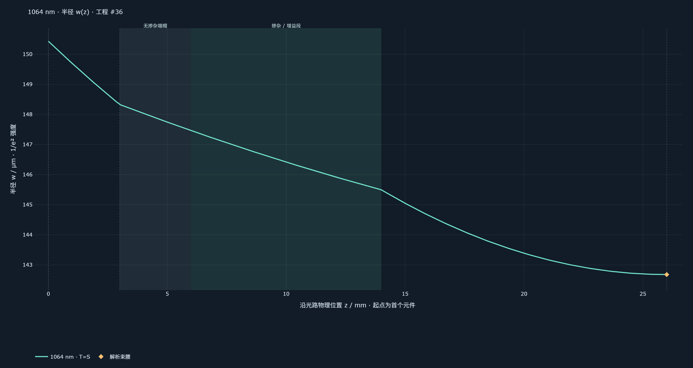
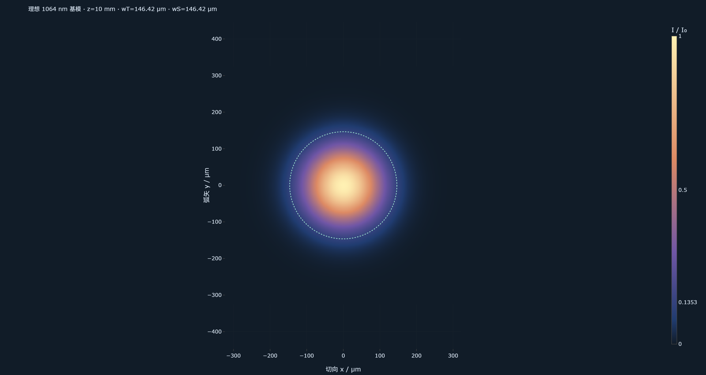

# LaserClaw 2.0

LaserClaw 2.0将自然语言任务、元件与测量资料、Agent工具编排、确定性光学计算和可编辑工程连接为一个实验工作流。

## 主要交付

- 首页支持API Key和Codex exec两种接入，Codex模式复用后端电脑上官方CLI的ChatGPT登录与订阅额度，默认模型为`gpt-6.1-sol`。
- 案例创建简化为标题和描述；Agent可以读取已有工程、库存、附件与历史计算，选择工具、检查输出、修正调用并提出有获取方法和单位的补测问题。
- 通用近轴光学模型支持单程、驻波腔和共面环形腔，T/S两轴、薄／厚透镜、GRIN、自定义ABCD、实测焦散拟合、一维扫描和二维稳定图。
- 工程提供已有器件参数锁定、版本历史、物理位置表、光场半径／包络、截面光斑和CSV／SVG／PNG导出。
- 计划、报告和案例概览优先使用最新光学工程；旧版本和原始参数保留为可追溯记录。
- 修复库存刷新、旧数据路径迁移、异步工具调用和生成内容证据传递等日常工作问题。

## 已批准的真实案例验收

[完整HTML报告](validation/review.html) · [数值审验JSON](validation/audit.json) · [原始Agent轮次](validation/run-final.json) · [可编辑模型](validation/project36.json) · [模半径CSV](validation/cold-field-radius.csv)

在已有R200 mm凹面输入镜、平面输出镜、总长11 mm／掺杂8 mm的Nd:YVO4晶体和808 nm泵浦条件下，真实Codex Agent成功完成10次读取／计算，并保存可编辑工程。条件候选为前间隙3 mm、后间隙12 mm、两镜间距26 mm；泵浦侧3 mm无掺杂端帽属于明确假设。

独立实现的矩阵计算核对两种朝向共3538个二维网格点，稳定性判断差异为0。冷腔掺杂中心计算半径146.417 μm，M2处束腰半径142.680 μm，均为1/e²强度半径。





以上为计算模式，未生成虚构泵浦曲线，未把显光纸反馈当作定量功率测量。验收结果明确为**部分完成：几何通过复核，最高输出功率与效率尚未求得**。

## 计算能力边界

当前运行LaserClaw Python/NumPy ABCD内核，未集成Rezonator C++运行时。稳定性、模尺寸和假设热透镜扫描不能预测真实输出功率，也不能证明全局最高效率。增益饱和、空间热场和无膜端面的复合腔反馈没有纳入当前通用求解器；实际泵浦焦散、镜片R/T、吸收、镀膜与冷却等测量仍需补充。

## 验证与复现

- 本地后端：540项测试通过，3项跳过；完整Ruff检查通过。
- 前端：ESLint与生产构建通过。Plotly按需加载，构建保留大文件体积提示。
- 真实订阅验收：连接、图片输入、Agent调用实际物理工具、保存结果与报告生成通过。常规CI使用Mock，不消耗订阅额度。
- 本报告的原始光学验收来自3.5.0开发构建；正式发布将前后端和前端包版本统一为2.0.0。旧文档中的v3.x是开发里程碑，并非已发布Git标签。

在仓库根目录、装有后端依赖的Python环境运行：

```powershell
backend/.venv/Scripts/python.exe docs/releases/2.0.0/validation/verify.py
```

Linux/macOS可使用相同环境中的`python docs/releases/2.0.0/validation/verify.py`。校验器直接读取随附原始工具记录并单独计算矩阵，不调用LaserClaw内核、模型接口或网络。

首次使用见[首页Codex配置](../../CODEX_EXEC.md)和[使用指南](../../GUIDE_V2.md)。本次发布沿用现有数据表，升级仍应保留数据目录及正常备份；不要将本机`.env`、Agent设置文件或实验数据库加入Git。
